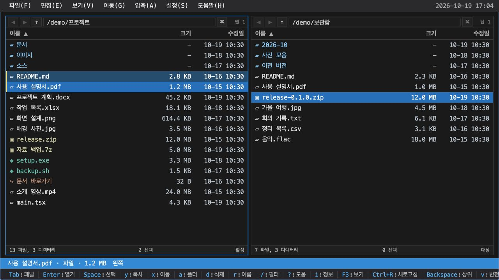
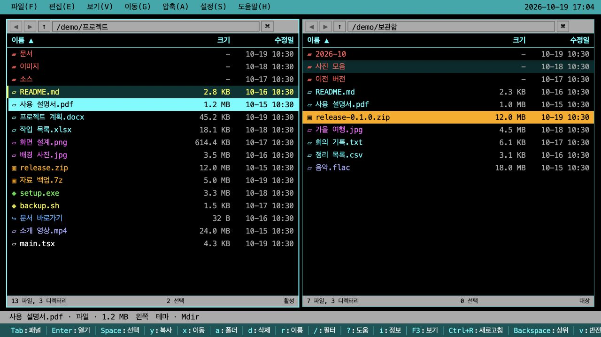

# BokslDirGUI · 복슬Dir

- **키보드 중심의 macOS·Windows 듀얼 패널 파일 매니저**
- 기존 터미널 기반 BokslDir의 조작감과 한눈에 들어오는 파일 목록을 데스크톱 GUI로 확장
- 두 폴더를 나란히 열어 파일 탐색·선택·복사·이동·압축 작업 수행
- **Tauri 2 + React 19 + TypeScript + Rust** 기반 구현



- 다크 테마의 듀얼 패널과 파일 다중 선택 화면
- 이 문서의 스냅샷은 실제 UI에 샘플 데이터를 연결한 브라우저 캡처이며, 운영체제 창 테두리 제외

## 주요 기능

| 기능 | 설명 |
| --- | --- |
| 듀얼 패널·탭 | 좌우 폴더의 독립 탐색, 패널별 탭, 패널 교환, 반대 패널을 대상으로 한 파일 작업 지원 |
| 키보드 중심 조작 | 방향키 탐색, Space 선택, 단축키 실행, 메뉴·컨텍스트 메뉴·마우스 조작 지원 |
| 파일 관리 | 복사·이동·삭제·폴더 생성·이름 변경·일괄 이름 변경, 충돌 처리·진행률·취소·오류 요약 지원 |
| 압축 파일 | 압축 파일 내부 탐색, 압축 생성·해제, ZIP·7z 암호 처리 지원 |
| 빠른 탐색 | 직접 경로 이동, 방문 기록, 북마크, 목록 필터·정렬 지원 |
| 파일 확인·비교 | 파일 정보, 텍스트 미리보기, 이름·종류·크기·수정일 기준 디렉터리 비교 지원 |
| 데스크톱 연동 | 시스템 파일 클립보드, 드래그 앤 드롭, 연결 앱으로 열기 지원 |
| 화면 설정 | 다크·라이트·고대비·Mdir 테마, 한국어·영어, 파일 크기 표시 형식 지원 |

## Mdir 테마



- 검은 배경과 청록색 메뉴를 사용하는 고전 파일 매니저 스타일
- 디렉터리의 붉은색, 문서·실행·이미지·압축·링크 등 파일 종류별 색상 구분
- 파일의 글자색을 배경색으로 사용하는 반전 포커스와 별도 선택 표시
- 설정 → 테마 → Mdir에서 선택 가능

## 기본 단축키

| 키 | 동작 |
| --- | --- |
| `Tab` | 좌우 활성 패널 전환 |
| `↑` / `↓`, `PageUp` / `PageDown` | 파일 목록 이동 |
| `Space` | 파일 선택·해제 |
| `Enter` | 폴더 진입 또는 파일 열기 |
| `Backspace` | 상위 폴더 이동 |
| `y` / `x` | 복사 / 이동 |
| `a` / `r` / `d` | 폴더 생성 / 이름 변경 / 삭제 |
| `/` | 목록 필터 |
| `F3` / `i` | 텍스트 미리보기 / 파일 정보 |
| `F9` / `?` | 메뉴 / 단축키 도움말 |

- 파일 목록에 포커스가 있을 때의 기본 단축키 기준
- 입력창·메뉴·다이얼로그에서는 해당 UI의 키보드 조작 우선
- 플랫폼별 검증 결과와 미검증 항목: [Windows 검증 기록](docs/implementation/windows-validation.md) 참조

## 개발 환경 구성

### 필요 환경

- Node.js `>= 24`
- npm
- Rust 1.93 이상 toolchain
- Tauri 개발에 필요한 OS별 시스템 의존성

- macOS 기준으로는 보통 Rust와 Xcode Command Line Tools가 필요

### 의존성 설치

```bash
npm ci
```

## 실행

### 웹 브라우저에서 개발 서버 실행

```bash
npm run dev
```

- 출력된 주소, 기본 `http://127.0.0.1:1420/`에서 브라우저 UI 확인
- 브라우저 모드는 샘플 데이터 기반 미리보기이며, 실제 파일 작업과 OS 연동 확인에는 아래 Tauri 데스크톱 앱 실행 필요

### Tauri 데스크톱 앱으로 실행

```bash
npm run tauri:dev
```

## 빌드

```bash
npm run build
```

- Tauri 앱 패키징이 필요하면:

```bash
npm run tauri:build
```

## 검증

- 전체 검증:

```bash
npm run verify
```

- 주요 개별 명령:

```bash
npm run typecheck   # TypeScript 타입 체크
npm test            # Vitest 테스트
npm run rust:test   # Rust 테스트
npm run verify:scope # full-scope smoke 검증
```

## 주요 디렉터리

- `src/` — React/TypeScript GUI, action registry, operation store, 테스트
- `src-tauri/` — Tauri/Rust backend command
- `scripts/` — 검증 스크립트
- `docs/implementation/` — 구현 기준 설계 문서
- `mockups/clickable-prototype/` — GUI 목업 참고 자료
